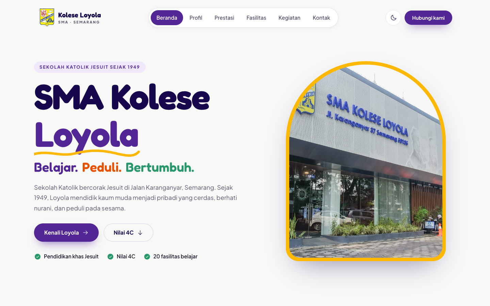
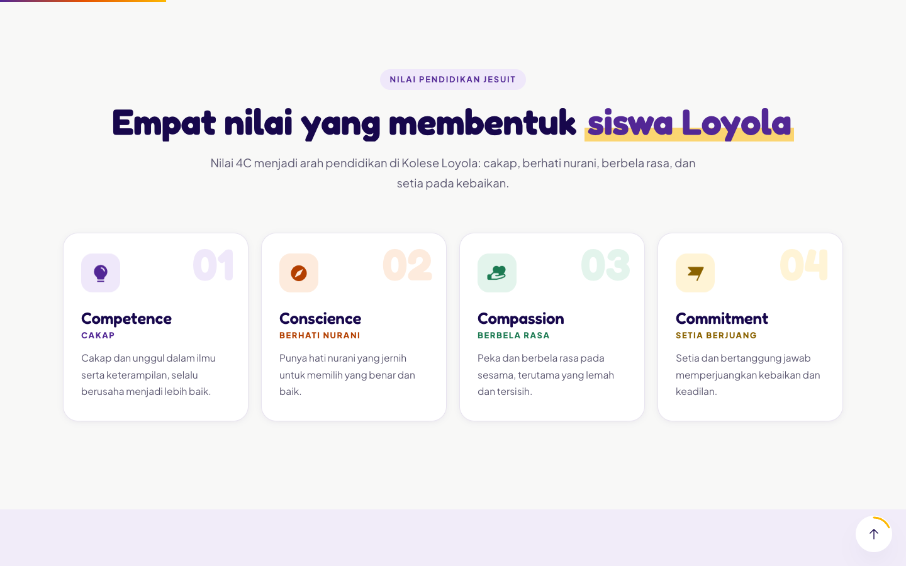
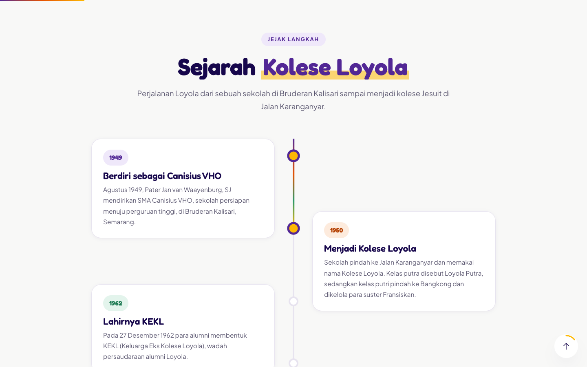
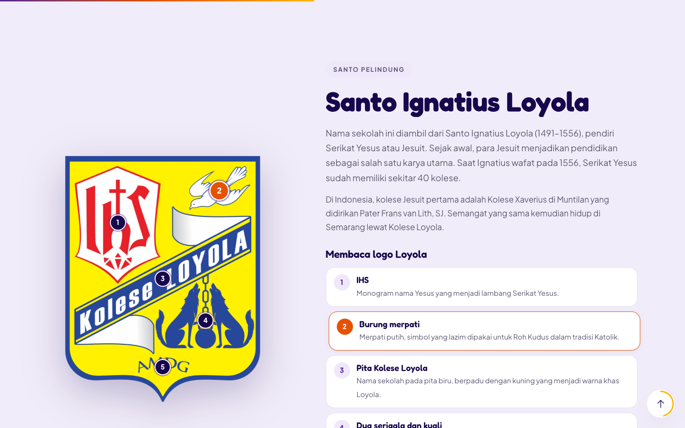
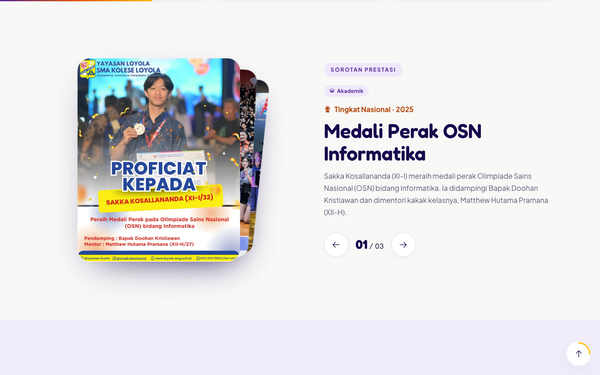
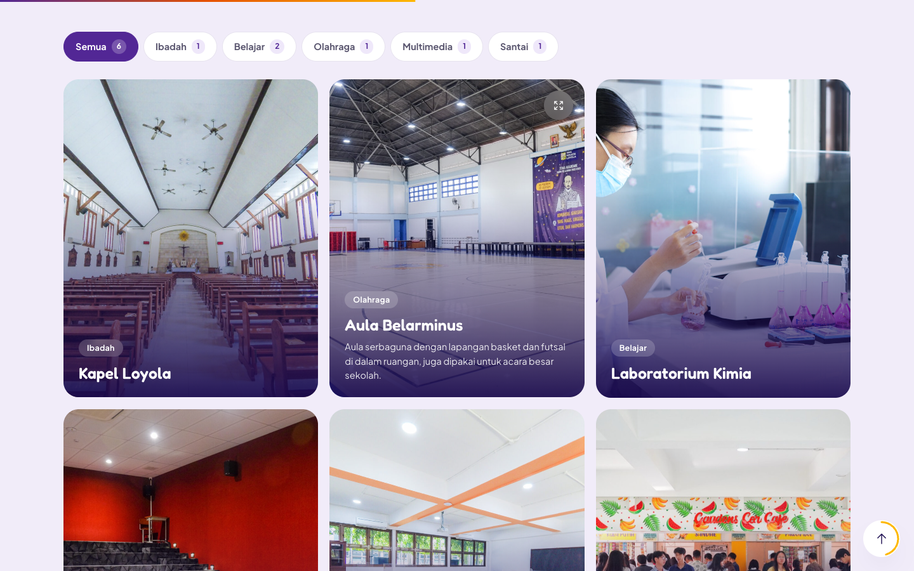
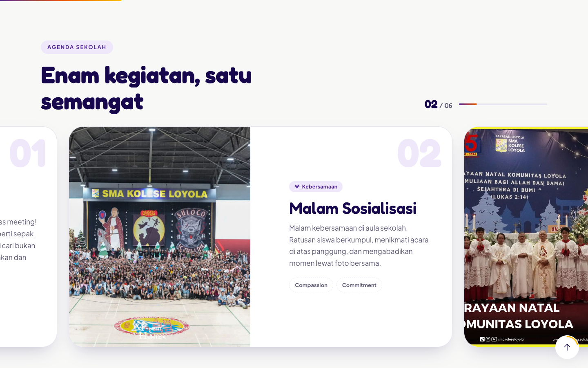
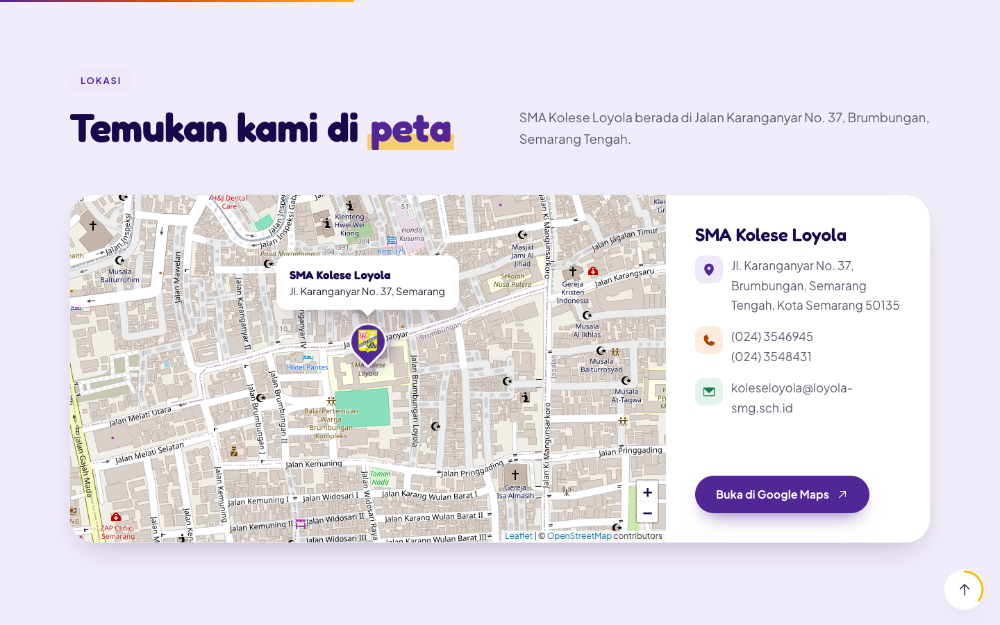
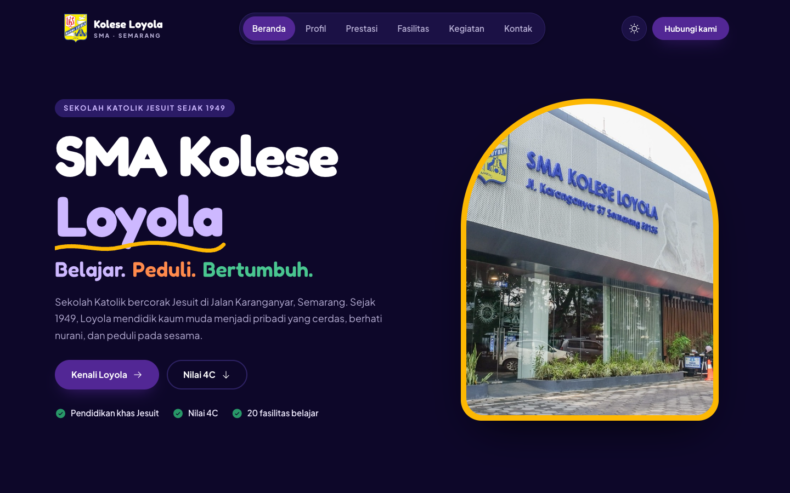
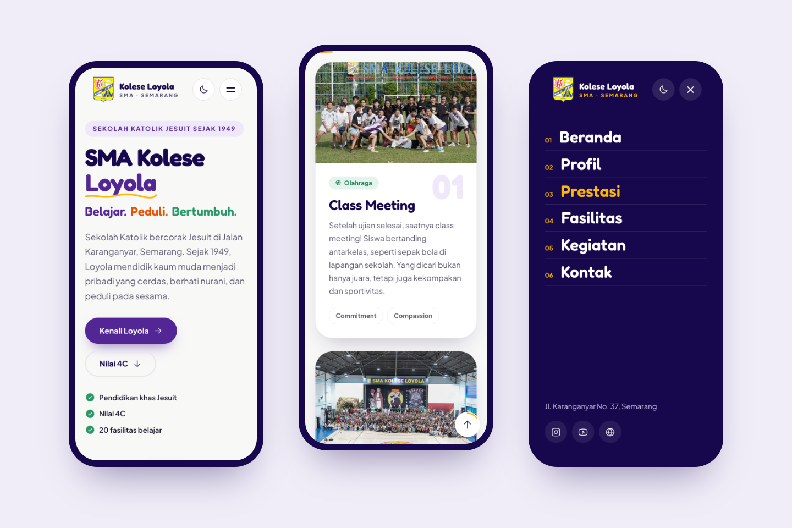

# Website SMA Kolese Loyola

Website profil SMA Kolese Loyola Semarang, sekolah Katolik Jesuit yang berdiri sejak 1949. Isinya ada beranda, profil dan sejarah sekolah, prestasi siswa, fasilitas, kegiatan sekolah, sampai kontak lengkap sama peta lokasinya.

Tampilannya pakai palet ungu, oranye, hijau, dan kuning, ditambah logo resmi sekolah. Hampir semua bagian dikasih animasi: judul yang muncul per baris, scroll yang halus, kegiatan yang bergeser ke samping, galeri yang bisa difilter, sampai mode gelap.

Websitenya statis, cuma pakai HTML, CSS, sama JavaScript biasa tanpa framework. Library animasi, galeri, dan petanya diambil lewat CDN.

Link website: https://yahya-nz.github.io/Website-SMA-Kolese-Loyola/

Catatan: ini project portofolio, bukan website resmi sekolah. Info resmi ada di [loyola-smg.sch.id](https://www.loyola-smg.sch.id).

## Tampilan

**Beranda**

Judul besar dengan coretan kuning dan foto gedung sekolah di bingkai lengkung. Pas pertama kali dibuka ada animasi pembuka dengan logo sekolah.



**Nilai 4C**

Empat kartu Competence, Conscience, Compassion, dan Commitment yang ikut miring kalau disorot kursor.



**Sejarah**

Garis waktu dari 1949 sampai 2024. Garisnya keisi warna pelan-pelan ngikutin scroll, dan titik tiap tahun langsung nyala begitu kelewatan.



**Membaca logo Loyola**

Logo sekolah dikasih titik bernomor. Arahkan kursor ke titik atau ke daftar penjelasannya, bagian yang sama bakal ikut disorot.



**Sorotan prestasi**

Tumpukan kartu yang bisa digeser, dan keterangannya ikut ganti sesuai kartu yang ada di depan. Di bawahnya ada daftar prestasi yang bisa difilter per bidang dan dicari pakai nama siswa atau nama lomba.



**Galeri fasilitas**

Filter kategori dengan animasi, kartu yang nampilin keterangan pas disorot, dan foto yang bisa dibuka besar.



**Kegiatan sekolah**

Enam kegiatan yang bergeser ke samping waktu halamannya di-scroll, lengkap sama nomor dan bar progres.



**Kontak dan peta**

Kartu kontak dengan tombol salin, peta OpenStreetMap yang terbang mendekat ke lokasi sekolah, dan tanya jawab yang bisa dibuka-tutup.



**Mode gelap**

Tombol bulan di pojok kanan atas. Pilihan temanya kesimpen di browser, dan kalau belum pernah dipilih, temanya ngikutin pengaturan perangkat.



**Tampilan di HP**

Menu berubah jadi tombol yang membuka menu layar penuh. Kegiatan yang tadinya bergeser ke samping jadi kartu yang tersusun ke bawah.



## Fitur

- Enam halaman: Beranda, Profil, Prestasi, Fasilitas, Kegiatan, dan Kontak.
- Animasi pembuka dengan logo dan hitungan persen, cuma muncul sekali tiap sesi.
- Transisi antarhalaman berupa tirai ungu dengan logo sekolah.
- Scroll halus, bar progres di atas layar, dan tombol kembali ke atas dengan lingkaran progres.
- Judul yang muncul per baris, elemen yang muncul saat di-scroll, angka yang ngitung naik, dan efek parallax di foto.
- Header yang ngumpet waktu scroll ke bawah dan muncul lagi waktu scroll ke atas.
- Tombol yang ketarik sedikit ke arah kursor (khusus laptop dan PC).
- Panel Jelajahi di beranda yang melebar pas disorot.
- Garis waktu sejarah dan logo sekolah dengan titik penjelasan.
- Kartu prestasi bertumpuk, filter bidang, dan pencarian.
- Galeri fasilitas dengan filter kategori dan lightbox.
- Kegiatan yang bergeser horizontal di laptop, plus galeri foto model masonry.
- Peta lokasi interaktif, tombol salin alamat, telepon, dan email, serta tanya jawab.
- Mode gelap.
- Responsif dari HP sampai layar lebar. Animasinya otomatis dikurangi kalau perangkat diatur ke "kurangi gerakan".

## Teknologi

- HTML, CSS, dan JavaScript biasa tanpa framework.
- [GSAP](https://gsap.com) dengan ScrollTrigger, SplitText, dan Flip buat animasi.
- [Lenis](https://github.com/darkroomengineering/lenis) buat scroll halus.
- [Swiper](https://swiperjs.com) buat tumpukan kartu prestasi.
- [GLightbox](https://github.com/biati-digital/glightbox) buat galeri foto.
- [Leaflet](https://leafletjs.com) dengan peta [OpenStreetMap](https://www.openstreetmap.org).
- [Vanilla Tilt](https://github.com/micku7zu/vanilla-tilt.js) buat kartu 4C yang miring.
- Ikon [Phosphor](https://phosphoricons.com), font Fredoka dan Plus Jakarta Sans dari Google Fonts.
- Semua library diambil lewat CDN jsDelivr, jadi nggak perlu install apa-apa.

## Struktur folder

```text
.
├── index.html             beranda
├── profil.html            sejarah, Santo Ignatius, logo, dan nilai sekolah
├── prestasi.html          sorotan dan daftar prestasi
├── fasilitas.html         gedung LSC, galeri, dan fasilitas lainnya
├── kegiatan.html          kegiatan sekolah dan galeri momen
├── kontak.html            kontak, peta, tanya jawab, dan sumber foto
├── assets
│   ├── css
│   │   └── style.css      tampilan semua halaman, termasuk mode gelap
│   ├── js
│   │   ├── main.js        scroll halus, header, menu, transisi, dan animasi umum
│   │   ├── beranda.js     animasi hero dan panel jelajahi
│   │   ├── profil.js      garis waktu dan titik di logo
│   │   ├── prestasi.js    kartu sorotan, filter, dan pencarian
│   │   ├── fasilitas.js   filter galeri fasilitas
│   │   ├── kegiatan.js    kegiatan yang bergeser horizontal
│   │   └── kontak.js      peta dan tanya jawab
│   └── img                foto sekolah dan logo
└── screenshot
```

## Cara menjalankan

1. Clone atau download repo ini.
2. Buka `index.html` di browser (Chrome, Firefox, Edge, atau Safari). Bisa juga lewat server lokal, misalnya `python3 -m http.server`, terus buka `http://localhost:8000`.
3. Pastikan konek internet, soalnya library, font, ikon, dan petanya diambil dari CDN. Kalau offline isinya tetap kebaca, cuma animasi, ikon, dan petanya nggak muncul.

## Sumber foto dan data

- Foto gedung dan fasilitas dari website resmi [loyola-smg.sch.id](https://www.loyola-smg.sch.id).
- Foto kegiatan, prestasi, dan poster dari Instagram resmi [@smakoleseloyola](https://www.instagram.com/smakoleseloyola), sebagian dokumentasi Moment Hunter.
- Sejarah, daftar fasilitas, dan daftar prestasi diambil dari website resmi sekolah.
- Peta &copy; OpenStreetMap contributors.
